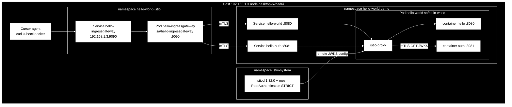

# Hello World RequestAuthentication

This is a working Istio JWT gate in front of two containers that one team owns and ships in one pod. You should already know Pods, Deployments, Services, namespaces, probes, and the idea of a sidecar. The Istio and JWT details you need for this repo are spelled out below.

## In this tree

| Path | What it holds |
|---|---|
| [`hello-world-demo/`](hello-world-demo/README.md) | The app namespace, its ServiceAccount, Deployment, Services, and both image sources. |
| [`hello-world-demo/hello/`](hello-world-demo/hello/README.md) | The API image. |
| [`hello-world-demo/auth/`](hello-world-demo/auth/README.md) | The signer image. |
| [`scripts/`](scripts/README.md) | Build, install, and the end-to-end proof. |
| [`istio-depoy.yaml`](istio-depoy.yaml) | Gateway namespace, dedicated ingress gateway, route, mesh-wide strict mTLS, and the JWT and default-deny policies. The filename spelling is the one this repo uses. |

## At a glance

**Who.** A microservice team owns both containers in the `hello-world` pod: `hello` (the API) and `auth` (the signer). Platform engineers own the k3s node, Istio's control plane in `istio-system`, and the registry in `infra`. The Cursor agent that built and called this demo runs on that same node.

**What.** Web clients send `Authorization: Bearer <jwt>` to `http://192.168.1.3:9090/api/v1/hello`. The ingress proxy opens mTLS to the pod proxy, which checks the token against a public key published by `auth` on port 8081. A missing token on that path gets 403. A malformed token gets 401. A valid token gets `hello world`. `GET /healthz` is the API path allowed with no token, so Kubernetes probes and health checks still get 200. `GET /token` and `GET /.well-known/jwks.json` are also open on port 8081, because a token cannot be required in order to mint one or to publish the key, and web clients still reach them only through this gateway.

**When.** The pod proxy fetches the public key from the signer over mTLS and caches it. `istiod` tells the proxy to do that fetch; it does not fetch the key itself. The token in this demo expires one hour after `GET /token` on the gateway. Istio also allows about 60 seconds of clock skew past `exp`.

**Where.** One host, `desktop-6vhed6i` at `192.168.1.3`, runs k3s and the agent. The gateway workload lives in namespace `hello-world-istio`. The pod, both Services, both `DestinationRule`s, `RequestAuthentication`, and both `AuthorizationPolicy` objects live in `hello-world-demo`. `istiod` 1.32.0 and mesh-wide `PeerAuthentication` live in `istio-system`.

**Why.** The API process stays free of signature code. The signer stays off `/api/v1/hello`. The mesh is the gate. The team still reviews one contract, because the issuer string, key id, algorithm, JWKS port, and `sub` claim are shared by the auth image and the Istio policy.

**How.** `scripts/build-push.sh` pushes both images to `sol:5000`. `scripts/install.sh` rolls out the pod, configures `istiod` to let Envoy fetch in-mesh JWKS over mTLS, then applies the gateway, mesh-wide strict mTLS, and the policies (idempotently, with no port-forward). `scripts/test.sh` proves gateway-only web entry, default-deny, JWT validation, rewritten kubelet probes, least-privilege pod identities, and pod-to-pod mTLS.

| Request | Status | Body | Who answered |
|---|---|---|---|
| `GET /api/v1/hello` with no `Authorization` header | 403 | `RBAC: access denied` | pod proxy, Envoy RBAC |
| `GET /api/v1/hello` with `Authorization: Bearer not-a-jwt` | 401 | `Jwt is not in the form of Header.Payload.Signature with two dots and 3 sections` | pod proxy, JWT filter |
| `GET /api/v1/hello` with the bearer token from `GET /token` | 200 | `hello world` | `hello`, after the proxy forwarded |
| `GET /healthz` with no token | 200 | `ok` | `hello`. `GET /healthz` is the health rule. |
| `GET /` or `POST /healthz` or `POST /token` with no token | 403 | `RBAC: access denied` | pod proxy. Default-deny covers every unmatched path and method. |

`content-length` was 19, 79, and 12 on the three `/api/v1/hello` responses. The 200 body is `hello world` plus the newline the process writes. Every status line included `server: istio-envoy`.

## Where



`kubectl` here is the k3s binary and reads `/etc/rancher/k3s/k3s.yaml`. Docker pushes to `sol:5000`, the `registry` Service on this node. `192.168.1.3:9090` is a local address, so `curl` needs no tunnel.

`hello-world-istio` holds `ServiceAccount/hello-ingressgateway`, the gateway Deployment, its Service, the Istio `Gateway`, and the `VirtualService`. `istio-system` holds `istiod` and the mesh-wide `PeerAuthentication/default` (`STRICT`). `hello-world-demo` holds `ServiceAccount/hello-world`, the application pod, both Services, both `DestinationRule`s, `RequestAuthentication`, `AuthorizationPolicy/hello-world-deny-all`, and `AuthorizationPolicy/hello-world`. Web clients do not enter through the default gateway in `istio-system`.

The pod has one IP and one network namespace, shared by every container ([Pod networking](https://kubernetes.io/docs/concepts/workloads/pods/#pod-networking)). `hello` binds 8080. `auth` binds 8081. Those two processes cannot both bind 8080. The `VirtualService` on this gateway sends exact `/token` and `/.well-known/jwks.json` to 8081, and every other path to 8080. Both of those hops are mTLS, from the gateway's proxy (`sa/hello-ingressgateway`) to the pod's proxy (`sa/hello-world`). Web clients use `http://192.168.1.3:9090` and have no other published address; direct plaintext or unauthenticated TLS to the pod IP or ClusterIPs is rejected by `PeerAuthentication` STRICT. Any meshed pod may call either Service directly over mTLS without going through the gateway.

## How a call is allowed

```mermaid
%%{init: {'theme':'base','themeVariables':{'darkMode':true,'background':'#000000','primaryColor':'#ffffff','primaryTextColor':'#000000','primaryBorderColor':'#000000','lineColor':'#ffffff','textColor':'#ffffff','mainBkg':'#ffffff','noteBkgColor':'#ffffff','noteTextColor':'#000000','noteBorderColor':'#000000','actorBkg':'#ffffff','actorBorder':'#ffffff','actorTextColor':'#000000','actorLineColor':'#ffffff','signalColor':'#ffffff','signalTextColor':'#ffffff','labelBoxBkgColor':'#000000','labelBoxBorderColor':'#ffffff','labelTextColor':'#ffffff','activationBkgColor':'#ffffff','activationBorderColor':'#000000'}}}%%
sequenceDiagram
  participant Client as Agent on the k3s host
  participant Gateway as hello-ingressgateway :9090
  participant Proxy as istio-proxy on the hello pod
  participant Hello as hello :8080
  participant Auth as auth :8081

  Note over Proxy,Auth: proxy fetches the key over mTLS and caches it
  Proxy->>Auth: mTLS GET /.well-known/jwks.json
  Auth-->>Proxy: JWKS for kid hello-auth-1

  Client->>Gateway: GET /token
  Gateway->>Proxy: mTLS to hello-auth.hello-world-demo:8081
  Proxy->>Auth: GET /token
  Auth-->>Client: RS256 JWT, iss hello-auth, sub demo-user
  Client->>Gateway: GET /api/v1/hello Authorization Bearer
  Gateway->>Proxy: mTLS to hello-world.hello-world-demo:8080
  Proxy->>Proxy: check iss, exp, and RS256 signature
  Proxy->>Hello: forward the request and the original token
  Hello-->>Client: 200 hello world
```

**Who checks the token.** The `istio-proxy` container in the hello pod. The gateway opens mTLS and forwards the bytes. It does not apply this demo's JWT rule. `auth` sees `GET /token` and `GET /.well-known/jwks.json`. It does not see `/api/v1/hello`.

**What is checked.** The bearer token in `Authorization`, which is the default place `JWTRule` looks. This repo sets no `fromHeaders`, `fromParams`, or `fromCookies`. The proxy checks `iss`, `exp`, and the RS256 signature. `forwardOriginalToken: true` leaves the header in place for `hello`.

**When the key is known.** `scripts/install.sh` sets `PILOT_JWT_ENABLE_REMOTE_JWKS=true` on `istiod`. The [pilot-discovery reference](https://istio.io/v1.32/docs/reference/commands/pilot-discovery/) defines that value as Envoy fetching the JWKS, with istiod as the fallback only when the JWKS host is outside the mesh. This host is inside the mesh, so the pod proxy fetches `jwksUri` over mTLS and caches the document. The default value `false` would make istiod fetch it. istiod is not injected, so that client cannot present a mesh certificate, and `PeerAuthentication` STRICT would refuse it. `scripts/install.sh` waits for `deployment/hello-world` to be Ready (confirming `auth` has parsed its key and answers probes) before applying the policies.

**Where the key is published.** Mesh callers read `http://hello-auth.hello-world-demo.svc.cluster.local:8081/.well-known/jwks.json`. Web clients read the same document at `http://192.168.1.3:9090/.well-known/jwks.json`. Both arrive at the pod proxy over mTLS, which allows `GET /.well-known/jwks.json` on port 8081 with no JWT.

**Why 403 and 401 differ.** Istio states the split:

> A request that does not contain any authentication credentials will be accepted but will not have any authenticated identity. To restrict access to authenticated requests only, this should be accompanied by an authorization rule.

Source: [RequestAuthentication](https://istio.io/v1.32/docs/reference/config/security/request_authentication/). The same page's per-path example is the shape used here.

```mermaid
%%{init: {'theme':'base','themeVariables':{'darkMode':true,'background':'#000000','primaryColor':'#ffffff','primaryTextColor':'#000000','primaryBorderColor':'#000000','secondaryColor':'#ffffff','secondaryTextColor':'#000000','secondaryBorderColor':'#000000','tertiaryColor':'#000000','tertiaryTextColor':'#ffffff','tertiaryBorderColor':'#ffffff','lineColor':'#ffffff','textColor':'#ffffff','mainBkg':'#ffffff','nodeBorder':'#000000','clusterBkg':'#000000','clusterBorder':'#ffffff','titleColor':'#ffffff','edgeLabelBackground':'#ffffff','nodeTextColor':'#000000'}}}%%
flowchart TD
  start[Request reaches the hello pod proxy] --> health{GET /healthz?}
  health -->|yes| probe[ALLOW health rule matches]
  probe --> ok[proxy forwards to the container]
  health -->|no| signer{Port 8081 and GET /token or JWKS?}
  signer -->|yes| authok[proxy forwards to auth]
  signer -->|no| present{Bearer present on port 8080?}
  present -->|no| principal[No request principal is set]
  principal --> rbac[No ALLOW rule matches]
  rbac --> deny[403 RBAC access denied]
  present -->|yes| shape{Three JWT sections and a valid signature?}
  shape -->|no| unauth[401 invalid_token]
  shape -->|yes| allow[requestPrincipals star matches]
  allow --> app[hello serves /api/v1/hello]
```

A missing token matches the default `OPTIONAL` presence. No principal is set. `GET /healthz` on either port matches a health rule. `GET /token` and `GET /.well-known/jwks.json` match only on port 8081 (non-GET methods such as `POST /token` get 403 at Envoy before reaching `auth`). Every other request to port 8080 has nothing to match until a valid token sets a principal, and Envoy RBAC returns 403. A malformed token fails `jwtRules` and returns 401. A token with `iss=hello-auth` and a live `exp`, signed by this key, produces principal `hello-auth/demo-user`. `*` matches any authenticated principal on port 8080, including `/api/v1/hello`.

**How `hello` uses the result.** It base64-decodes the payload and logs `iss` and `sub`. It does not check the signature. `GET /api/v1/hello` returns `hello world`. `GET /healthz` returns `ok`. Any other path that reaches the process is 404. Both processes serve GET only and return 405 on other methods (`result=method_not_allowed`). `auth` also sends `Cache-Control: no-store` on `/token` and refuses non-GET in process even if Envoy were absent.

## Which requests must carry a token

Istio splits "is this credential valid?" from "must a credential be present?". [RequestAuthentication](https://istio.io/v1.32/docs/reference/config/security/request_authentication/) says:

> A request that does not contain any authentication credentials will be accepted but will not have any authenticated identity. To restrict access to authenticated requests only, this should be accompanied by an authorization rule.

The same page's `JWTRule.presence` field defaults to `OPTIONAL`: a missing token is allowed, and an invalid token is rejected. `issuer` rejects a JWT whose `iss` claim differs. `forwardOriginalToken` defaults to false; this repo sets it true so `hello` still sees `Authorization`. The selector matches workloads in the policy's own namespace. A policy in the mesh root, `istio-system`, can match every namespace.

[AuthorizationPolicy](https://istio.io/v1.32/docs/reference/config/security/authorization-policy/) then decides. For `ALLOW`, Istio's order is: if no ALLOW policy selects the workload, allow the request; if an ALLOW rule matches, allow it; otherwise deny it. An empty `rules` list never matches, which denies the selected workloads. `requestPrincipals` is `<issuer>/<subject>`, and `*` is a presence match: it matches when the value is not empty.

Three shapes cover this demo. This repo uses the third, layered on an explicit empty-rules default-deny policy (`hello-world-deny-all`).

| Shape | What a caller sees | Where it is written |
|---|---|---|
| `RequestAuthentication` only | Missing token: the request proceeds with no principal. Bad token: 401. | The reference's opening paragraph. |
| `ALLOW` with only `requestPrincipals: ["*"]` | Every path requires a valid token, including probes. Kubelet can still succeed if `sidecar.istio.io/rewriteAppHTTPProbers` sends probes to the sidecar agent, which skips the filter. | The reference's first example, plus the [annotations](https://istio.io/v1.32/docs/reference/config/annotations/) page: that annotation "Rewrite[s] HTTP readiness and liveness probes to be redirected to the Envoy sidecar." |
| `ALLOW` with a principal rule and a path rule | `/healthz` is allowed with no token. Every other path requires a valid token. | The reference's per-path example, quoted below. This repo starts from that example. |

The [RequestAuthentication reference](https://istio.io/v1.32/docs/reference/config/security/request_authentication/) gives the shape this repo copies:

> You can fine-tune the authorization policy to set different requirement per path. For example, to require JWT on all paths, except `/healthz`, the same `RequestAuthentication` can be used, but the authorization policy could be:

```yaml
rules:
- from:
  - source:
      requestPrincipals: ["*"]
- to:
  - operation:
      paths: ["/healthz"]
```

`istio-depoy.yaml` pairs an explicit empty-rules policy (`hello-world-deny-all`) with a narrowed `ALLOW` policy (`hello-world`). Even if the allow policy is removed, `hello-world-deny-all` keeps the pod closed. A validated principal is allowed on port 8080. `GET /healthz` is allowed on port 8080 and port 8081, and any other method on `/healthz` is denied. `GET /token` and `GET /.well-known/jwks.json` are allowed only on port 8081. Those signer paths stay open on GET because a caller cannot present a token in order to mint one, and the proxy cannot present one in order to learn the key. They still pass through Envoy, and mesh-wide `PeerAuthentication` STRICT requires mTLS on that hop. A web client reaches them only at `http://192.168.1.3:9090`. A meshed pod may call `Service/hello-auth` directly over mTLS. Tokenless `POST /healthz`, `POST /token`, `GET /`, `GET /no-such`, and `GET /token/extra` match no rule and return 403.

The [end-user authentication task](https://istio.io/v1.32/docs/tasks/security/authentication/authn-policy/) shows the same 401 and 403 on an ingress, with a different policy shape: a `DENY` rule of `notRequestPrincipals: ["*"]`. That DENY covers every path, including a health check. A health exception would be a narrower rule beside it. This repo uses the ALLOW example above instead.

`PeerAuthentication/default` in `istio-system` sets `mtls.mode: STRICT` for the entire mesh. [Security best practices](https://istio.io/v1.32/docs/ops/best-practices/security/) say permissive mode "will accept both mutual TLS and plaintext traffic" and recommend strict mode "to enforce that mutual TLS is used." Every sidecar-injected pod in every namespace requires mTLS on inbound traffic. Gateway inbound TLS is configured on the `Gateway` resource itself, so port 9090 stays open for web clients outside the mesh while mTLS begins on the gateway's outbound connection. The two `DestinationRule` resources set `tls.mode: ISTIO_MUTUAL`, which is the mode in the [DestinationRule reference](https://istio.io/v1.32/docs/reference/config/networking/destination-rule/) example that "configures a client to use Istio mutual TLS." `rewriteAppHTTPProbers: "true"` redirects kubelet probes for both `hello` and `auth` to the sidecar agent on port 15020, so Kubernetes probes need neither a mesh certificate nor a JWT.

## How the key works

**Who holds it.** The `auth` process holds the private key. The pod proxy holds the public half after it fetches the JWKS. `hello` holds neither. The gateway does not check this demo's JWT.

**What it is.** A 2048-bit RSA key. The recorded signature was 256 bytes, which is the size of that modulus. The demo stores it as a PKCS#8 PEM in [`hello-world-demo/auth/key.go`](hello-world-demo/auth/key.go). `mustPrivateKey` parses that PEM at startup and accepts only an RSA key. `kid` is the constant `hello-auth-1`. The signer writes that same label into the JWT header and into the JWK. [RFC 7517 appendix A.1](https://www.rfc-editor.org/rfc/rfc7517#appendix-A.1) describes a public JWK the same way: `kty`, `n`, `e`, `alg`, and `kid`, "for key matching purposes," with integers as the base64url encoding of their big-endian bytes. The private parameters (`d`, `p`, `q`) are not in the document this process serves.

**Where it comes from.** This demo compiles the PEM into the image so a restart presents the same modulus the proxy already cached. A deployment mounts that PEM string from a key vault, or a similar secret store. That string is the only secret in this repository. Issued tokens are not stored. `n` and `e` are public. Mesh certificates are issued by istiod and are not in this repo. Because this Gateway is HTTP only and terminates no TLS, this repo creates no Secret-reading RBAC for the gateway; a deployment that terminates TLS at the edge adds an SDS Role scoped to `ServiceAccount/hello-ingressgateway`, never to `default`.

**When it is used.** Parsing happens once, at process start. `GET /token` signs and responds with `Cache-Control: no-store`. `GET /.well-known/jwks.json` writes the public half. `POST /token` is denied by Envoy (403) and is also rejected in process with 405 without signing. With `PILOT_JWT_ENABLE_REMOTE_JWKS=true`, the pod proxy fetches the JWKS document over mTLS and uses the cached key on the user request. The default `false` path, `JwksResolver.BuildLocalJwks` in [Istio 1.32.0](https://github.com/istio/istio/blob/1.32.0/pilot/pkg/model/jwks_resolver.go), would make istiod fetch the key without a sidecar certificate, which fails under STRICT mTLS.

**Why the proxy can check the signature.** [RFC 7518 §3.3](https://www.rfc-editor.org/rfc/rfc7518#section-3.3) defines `RS256` as "RSASSA-PKCS1-v1_5 using SHA-256." `auth` base64url-encodes the header and the payload without padding, hashes `header.payload`, and signs that digest with the private key. The proxy repeats the hash and checks it with `n` and `e`. The [authentication task](https://istio.io/v1.32/docs/tasks/security/authentication/authn-policy/) states the clock rule this cluster is using: the token "will become valid 60 seconds earlier than its configured `nbf` and remain valid 60 seconds after its configured `exp`." This token sets no `nbf` and no `aud`, and the rule sets no `audiences`.

**How a rotation would go.** A new PEM changes `n`. Tokens from the new key fail verification until the pod proxy has fetched the new JWKS. Keeping `kid` the same while changing `n` leaves the proxy on the old public key. Publishing the new key under a new `kid`, in both the header and the JWK, is how a set can carry two keys across a cutover. This demo ships one key and one `kid`.

| Claim or field | Value | Why |
|---|---|---|
| `alg` | `RS256` | Names the RSA SHA-256 signature. |
| `kid` | `hello-auth-1` | Selects this JWK out of the set. |
| `iss` | `hello-auth` | Must equal `jwtRules.issuer`. |
| `sub` | `demo-user` | Subject half of principal `hello-auth/demo-user`. |
| `iat` | now | Issued-at ([RFC 7519](https://www.rfc-editor.org/rfc/rfc7519)). |
| `exp` | now plus one hour | An expired token is rejected, plus about 60 seconds of skew. |

The compact form is `base64url(header).base64url(payload).base64url(signature)` ([RFC 7515](https://www.rfc-editor.org/rfc/rfc7515)). The JWK Set document is [RFC 7517](https://www.rfc-editor.org/rfc/rfc7517).

## Open standards vs. this demo

Not every path or header in this repo has the same status. Some pieces come straight from IETF RFCs or CNCF/OpenID specifications, some are widespread industry conventions (not formally registered), and the rest belong only to this demo.

### From open standards

| Piece | Standard | How it appears here |
|---|---|---|
| `Authorization: Bearer <token>` and `WWW-Authenticate: Bearer ... error="invalid_token"` | [RFC 6750 §2.1](https://www.rfc-editor.org/rfc/rfc6750#section-2.1), [§3](https://www.rfc-editor.org/rfc/rfc6750#section-3), [§3.1](https://www.rfc-editor.org/rfc/rfc6750#section-3.1) | How clients pass the JWT to the gateway and how Envoy formats the `401 Unauthorized` error header. |
| Compact JWS (`header.payload.signature`, base64url without padding) and `kid` header | [RFC 7515 §3.1](https://www.rfc-editor.org/rfc/rfc7515#section-3.1), [§4.1.4](https://www.rfc-editor.org/rfc/rfc7515#section-4.1.4) | Wire format emitted by `auth` and parsed by Envoy. |
| JWK and JWK Set (`keys`, `kty`, `kid`, `use`, `alg`, `n`, `e`) | [RFC 7517 §4](https://www.rfc-editor.org/rfc/rfc7517#section-4), [§5](https://www.rfc-editor.org/rfc/rfc7517#section-5), [Appendix A.1](https://www.rfc-editor.org/rfc/rfc7517#appendix-A.1) | JSON body returned by `auth` and cached by Envoy. |
| `RS256` (`RSASSA-PKCS1-v1_5` with SHA-256) and RSA JWK parameters | [RFC 7518 §3.3](https://www.rfc-editor.org/rfc/rfc7518#section-3.3), [§6.3](https://www.rfc-editor.org/rfc/rfc7518#section-6.3) | Signing algorithm used by `auth` and verified by Envoy. |
| JWT registered claims (`iss`, `sub`, `aud`, `exp`, `nbf`, `iat`, `jti`) and `typ: "JWT"` | [RFC 7519 §4.1](https://www.rfc-editor.org/rfc/rfc7519#section-4.1), [§5.1](https://www.rfc-editor.org/rfc/rfc7519#section-5.1), [IANA JWT Registry](https://www.iana.org/assignments/jwt/jwt.xhtml) | This demo sets `iss`, `sub`, `iat`, and `exp` and omits `aud`, `nbf`, and `jti`. |
| JWT validation guidance (checking algorithm, issuer, and expiry; never trusting unverified payloads) | [RFC 8725 §3.1](https://www.rfc-editor.org/rfc/rfc8725#section-3.1), [§3.8](https://www.rfc-editor.org/rfc/rfc8725#section-3.8) | Enforced by Envoy's JWT filter before forwarding to `hello`. |
| `/.well-known/` URI prefix and OAuth/OIDC discovery metadata (`/.well-known/oauth-authorization-server`, `/.well-known/openid-configuration`, `jwks_uri`) | [RFC 8615 §3](https://www.rfc-editor.org/rfc/rfc8615#section-3), [IANA Well-Known URIs](https://www.iana.org/assignments/well-known-uris/well-known-uris.xhtml), [RFC 8414 §2–§3](https://www.rfc-editor.org/rfc/rfc8414#section-3), [OpenID Connect Discovery 1.0](https://openid.net/specs/openid-connect-discovery-1_0.html) | Standard discovery pattern; see the note on `/.well-known/jwks.json` below. |
| `Cache-Control: no-store` on token responses | [RFC 6749 §5.1](https://www.rfc-editor.org/rfc/rfc6749#section-5.1), [RFC 9111 §5.2.2.5](https://www.rfc-editor.org/rfc/rfc9111#section-5.2.2.5) | Sent by `auth` on `GET /token` so caches do not store bearer tokens. |
| HTTP status codes `401`, `403`, `405` + `Allow: GET` | [RFC 9110 §15.5.2](https://www.rfc-editor.org/rfc/rfc9110#section-15.5.2), [§15.5.4](https://www.rfc-editor.org/rfc/rfc9110#section-15.5.4), [§15.5.6](https://www.rfc-editor.org/rfc/rfc9110#section-15.5.6), [§10.2.1](https://www.rfc-editor.org/rfc/rfc9110#section-10.2.1) | Returned by Envoy (`401`, `403`) and by `hello`/`auth` (`405` with `Allow: GET`). |
| Mesh mTLS workload identity (`spiffe://...` X.509-SVID over TLS 1.3) | [SPIFFE ID](https://github.com/spiffe/spiffe/blob/main/standards/SPIFFE-ID.md), [X.509-SVID](https://github.com/spiffe/spiffe/blob/main/standards/X509-SVID.md), [RFC 8446](https://www.rfc-editor.org/rfc/rfc8446) | Identities verified on every gateway-to-pod and pod-to-pod mTLS hop. |

### Common conventions (not formally registered in an RFC)

- **`/.well-known/jwks.json`.** The `/.well-known/` prefix comes from [RFC 8615](https://www.rfc-editor.org/rfc/rfc8615), and the JSON body comes from [RFC 7517 §5](https://www.rfc-editor.org/rfc/rfc7517#section-5), but `jwks.json` itself is **not** registered in the [IANA Well-Known URIs Registry](https://www.iana.org/assignments/well-known-uris/well-known-uris.xhtml). In OAuth 2.0 ([RFC 8414 §2–§3](https://www.rfc-editor.org/rfc/rfc8414#section-2)) and [OpenID Connect Discovery 1.0](https://openid.net/specs/openid-connect-discovery-1_0.html), the registered discovery endpoints are `/.well-known/oauth-authorization-server` and `/.well-known/openid-configuration`, and those documents advertise a `jwks_uri` pointing to wherever the provider hosts its keys (for example `/.well-known/jwks.json`, `/oauth2/v3/certs`, or `/protocol/openid-connect/certs`). This demo skips the discovery document and points Istio's `jwksUri` directly at `/.well-known/jwks.json`.
- **`/healthz`.** A Kubernetes ecosystem convention rather than an IETF standard. Kubernetes has since moved API-server health paths toward `/livez` and `/readyz` ([Kubernetes API Health Endpoints](https://kubernetes.io/docs/reference/using-api/health-checks/)), and Istio's probe rewriter exposes `/app-health/<container>/livez` and `/readyz` on port 15020. This demo keeps `/healthz` to match Istio's canonical [RequestAuthentication](https://istio.io/v1.32/docs/reference/config/security/request_authentication/) example.
- **Istio CRDs and SPIFFE path shape.** `RequestAuthentication`, `AuthorizationPolicy`, `PeerAuthentication`, `DestinationRule`, `Gateway`, `VirtualService`, `PILOT_JWT_ENABLE_REMOTE_JWKS`, `sidecar.istio.io/rewriteAppHTTPProbers`, and the `/ns/<namespace>/sa/<service-account>` SPIFFE path convention are Istio project conventions rather than IETF standards.

### Specific to this demo project

- **Demo routes (`/api/v1/hello` and unauthenticated `GET /token`).** Real OAuth 2.0 token endpoints use `POST` with client and grant credentials ([RFC 6749 §3.2](https://www.rfc-editor.org/rfc/rfc6749#section-3.2)) and are discovered via `token_endpoint` in server metadata rather than hardcoded at `GET /token`.
- **Demo claims and identifiers.** `iss=hello-auth` (OAuth 2.0 / OIDC issuers are HTTPS URLs per [RFC 8414 §2](https://www.rfc-editor.org/rfc/rfc8414#section-2)), fixed `sub=demo-user`, single `kid=hello-auth-1`, 1-hour `exp`, and omitted `aud`, `nbf`, and `jti`.
- **Compiled-in demo key.** [`hello-world-demo/auth/key.go`](hello-world-demo/auth/key.go) embeds a static RSA key so restarts preserve the cached `kid`; a real deployment mounts keys from a KMS or secret store and rotates `kid`.
- **Cluster layout and naming.** Namespaces `hello-world-demo` and `hello-world-istio`, dedicated gateway on `192.168.1.3:9090`, two containers (`hello` on `:8080`, `auth` on `:8081`) sharing one pod, in-cluster registry `sol:5000`, and manifest filename `istio-depoy.yaml`.

## Why these two containers share a pod

Picture Shelf, a small internal document API. `hello` is the read API. `auth` is the signer this team runs for Shelf. The portal trades a company session for a Shelf token (`GET /token` here always signs `sub=demo-user`; a production handler would set `sub` to the employee id). The browser calls the gateway. The API returns that employee's documents and logs `sub`.

**Who owns the cut.** The same team owns both images, the pod spec, and the workload policies. Platform owns `istiod`, mesh-wide `PeerAuthentication`, and the node. The team can ship a new `hello` image without rebuilding `auth`. A change to the rows below is one review across `hello-world-demo/auth` and `istio-depoy.yaml`.

| Shared fact | Written by | Read by |
|---|---|---|
| `iss=hello-auth` | `auth`, in the payload | `jwtRules.issuer` |
| `kid=hello-auth-1`, `alg=RS256` | `auth`, in the header and the JWK | the proxy, choosing a key from the set |
| JWKS on `:8081` at `/.well-known/jwks.json` | `auth` and `Service/hello-auth` | the pod proxy, over mTLS, via `jwksUri` |
| `sub` is the caller id | `auth` | `hello`, for logs and for which rows to return |
| mTLS to both Service ports | mesh-wide `PeerAuthentication` STRICT and both `DestinationRule`s | the gateway, and any other pod on the mesh |

**What stays local.** Document rules that need the database stay in `hello`. The mesh rule stays coarse: some token this team signed. Stable rules that need no database, such as "only GET", live in `AuthorizationPolicy` and are also enforced in process. The private key stays with `auth`. This demo compiles the PKCS#8 PEM into `key.go`. A deployment mounts that string from a key vault, or a similar secret store, and mounts any other secret the same way. `hello` never imports the key and never calls `/token` while serving a read.

**When colocation is the right call.** While Shelf is the only audience and minting is rare, one pod is enough. They become ready together because each container has a probe, and they share a network namespace so the ports are a pod-level decision. Split the signer into its own Deployment when a second API needs the same tokens, or when the signer must stay up while Shelf rolls. Keep `iss` and the JWKS document stable; point `jwksUri` at the new Service. If a company identity provider replaces this signer, remove the auth container, point `jwksUri` at that provider, and keep `hello` keyed on `sub`.

**Why `hello` does not verify the signature.** The proxy already did. Re-implementing RSA in the API duplicates the contract and drifts. The deploy invariant is "this pod is injected, and the `ALLOW` rule on `requestPrincipals` is present." A forged `sub` matters if that invariant is removed.

## What was recorded

`scripts/test.sh` finished at `2026-11-23T21:15:26Z` and printed:

```text
waiting for http://192.168.1.3:9090
web client to http://10.42.0.154:8080/healthz failed (want failure)
web client to http://10.42.0.154:8081/healthz failed (want failure)
web client to https://10.42.0.154:8080/healthz failed (want failure)
web client to http://10.43.49.132:8080/healthz failed (want failure)
web client to http://10.43.116.97:8081/healthz failed (want failure)
pod/mesh-client condition met
pod/plain-client condition met
mesh PeerAuthentication istio-system/default: STRICT (want STRICT)
DestinationRules: hello-world=ISTIO_MUTUAL hello-auth=ISTIO_MUTUAL (want ISTIO_MUTUAL)
gateway no token /api/v1/hello: 403 (want 403)
gateway no token /: 403 (want 403)
gateway no token /no-such: 403 (want 403)
gateway no token /token/extra: 403 (want 403)
gateway POST /healthz: 403 (want 403)
gateway POST /token: 403 (want 403)
gateway GET /healthz: 200 body=ok (want 200 ok)
gateway jwks: 200 (want 200)
gateway bad token: 401 (want 401)
gateway good token: 200 body=hello world (want 200 hello world)
gateway authed /no-such: 404 (want 404)
gateway authed POST /api/v1/hello: 405 (want 405)
pod ready: True containers: auth=true hello=true istio-init=true istio-proxy=true
pod probe ports: hello=15020/app-health/hello/livez/15020/app-health/hello/readyz auth=15020/app-health/auth/livez/15020/app-health/auth/readyz
hello probe log: 2026/11/23 21:15:16 from=127.0.0.6:48687 method=GET path=/healthz status=200 bytes=3 result=probe user=none
auth probe log: 2026/11/23 21:15:16 from=127.0.0.6:56339 method=GET path=/healthz status=200 bytes=3 result=ok
identities: app=hello-world:false gw=hello-ingressgateway:false gw_roles=none app_sa_token=none
mesh pod to hello /api/v1/hello (no token): 403 (want 403)
mesh pod to hello /api/v1/hello (with token): 200 (want 200)
mesh pod to hello /healthz: 200 (want 200)
mesh pod to hello /token: 403 (want 403)
mesh pod to signer /healthz: 200 (want 200)
mesh pod to signer /token: 200 (want 200)
plain pod to hello and signer: closed (want closed)
pod-to-pod security: mutual_tls plaintext_200=no (want mutual_tls no)
secret leaks in app logs: none (want none)
```

Pod `hello-world-558bcf7d56-7f2m6` was Ready on `10.42.0.154`. The minted token was not copied. Plaintext and unauthenticated TLS from this host to the pod IP, and plaintext to both ClusterIPs, failed. A pod with a sidecar reached both Services directly over `mutual_tls` (403 without a token, 200 with a valid token, 200 on `/healthz`, 403 on `:8080/token`). A pod without a sidecar failed on both ports. The gateway returned the verbatim responses below.

`GET /api/v1/hello` with no header. The proxy answers, and `hello` does not see the request:

```text
HTTP/1.1 403 Forbidden
content-length: 19
content-type: text/plain
date: Mon, 23 Nov 2026 21:15:37 GMT
server: istio-envoy
x-envoy-upstream-service-time: 0

RBAC: access denied
```

`GET /`, `GET /no-such`, `GET /token/extra`, `POST /healthz`, and `POST /token` with no header return the same 403 from Envoy RBAC. The default is closed. `GET /healthz` is the health rule.

`GET /healthz` with no header:

```text
HTTP/1.1 200 OK
content-type: text/plain; charset=utf-8
date: Mon, 23 Nov 2026 21:15:38 GMT
content-length: 3
x-envoy-upstream-service-time: 0
server: istio-envoy

ok
```

`Authorization: Bearer not-a-jwt` on `/api/v1/hello`:

```text
HTTP/1.1 401 Unauthorized
www-authenticate: Bearer realm="http://192.168.1.3:9090/api/v1/hello", error="invalid_token"
content-length: 79
content-type: text/plain
date: Mon, 23 Nov 2026 21:15:37 GMT
server: istio-envoy
x-envoy-upstream-service-time: 0

Jwt is not in the form of Header.Payload.Signature with two dots and 3 sections
```

Valid token, `GET /api/v1/hello`. The 12 bytes are `hello world` plus a newline (`68 65 6c 6c 6f 20 77 6f 72 6c 64 0a`):

```text
HTTP/1.1 200 OK
content-type: text/plain; charset=utf-8
date: Mon, 23 Nov 2026 21:15:38 GMT
content-length: 12
x-envoy-upstream-service-time: 0
server: istio-envoy

hello world
```

The same token on `GET /no-such` passed the proxy. `hello` has no such route:

```text
HTTP/1.1 404 Not Found
content-type: text/plain; charset=utf-8
x-content-type-options: nosniff
date: Mon, 23 Nov 2026 21:15:38 GMT
content-length: 19
x-envoy-upstream-service-time: 0
server: istio-envoy

404 page not found
```

`POST /api/v1/hello` with that token reached `hello`, which allows GET only:

```text
HTTP/1.1 405 Method Not Allowed
allow: GET
content-type: text/plain; charset=utf-8
x-content-type-options: nosniff
date: Mon, 23 Nov 2026 21:15:38 GMT
content-length: 20
x-envoy-upstream-service-time: 0
server: istio-envoy

method not allowed
```

Kubernetes kept the probes working. `kubectl describe` on pod `hello-world-558bcf7d56-7f2m6` shows the rewritten probe addresses for both containers, which is what `rewriteAppHTTPProbers` does:

```text
Liveness:     http-get http://:15020/app-health/hello/livez delay=0s timeout=1s period=10s #success=1 #failure=3
Readiness:    http-get http://:15020/app-health/hello/readyz delay=0s timeout=1s period=5s #success=1 #failure=3
Liveness:     http-get http://:15020/app-health/auth/livez delay=0s timeout=1s period=10s #success=1 #failure=3
Readiness:    http-get http://:15020/app-health/auth/readyz delay=0s timeout=1s period=5s #success=1 #failure=3
```

Conditions included `Ready` and `ContainersReady`. Each container still saw the check as `GET /healthz` from the sidecar agent. `hello` logged `user=none`. `auth` logged `result=ok`.

```text
hello: 2026/11/23 21:15:37 from=127.0.0.6:39211 method=GET path=/healthz status=200 bytes=3 result=probe user=none
auth:  2026/11/23 21:15:37 from=127.0.0.6:44843 method=GET path=/healthz status=200 bytes=3 result=ok
```

The 403 and 401 responses are absent from both container logs because the proxy returned them. `auth` logged the token issue; `bytes` is the response size, and the token, modulus, and exponent are not logged.

```text
2026/11/23 21:15:38 from=127.0.0.6:53714 method=GET path=/token status=200 bytes=504 result=issued iss=hello-auth sub=demo-user kid=hello-auth-1 exp=1795472138
```

`from=127.0.0.6` is the pod proxy. The mTLS connection ends there, and the proxy opens a local connection to `auth` or `hello`. `hello` logged the calls that the proxy accepted, with `iss` and `sub` matching the issue line:

```text
2026/11/23 21:15:38 from=127.0.0.6:56736 method=GET path=/healthz status=200 bytes=3 result=probe user=none
2026/11/23 21:15:38 from=127.0.0.6:56736 method=GET path=/api/v1/hello status=200 bytes=12 result=served iss=hello-auth sub=demo-user
2026/11/23 21:15:38 from=127.0.0.6:56736 method=GET path=/no-such status=404 bytes=19 result=not_found iss=hello-auth sub=demo-user
2026/11/23 21:15:38 from=127.0.0.6:56736 method=POST path=/api/v1/hello status=405 bytes=20 result=method_not_allowed iss=hello-auth sub=demo-user
```

The sidecar's `istio_requests_total` metric recorded `connection_security_policy=mutual_tls` for every accepted and rejected call:
- Gateway (`spiffe://cluster.local/ns/hello-world-istio/sa/hello-ingressgateway`) to `hello-world` (`spiffe://cluster.local/ns/hello-world-demo/sa/hello-world`): 200, 401, 403, 404, 405, all `mutual_tls`.
- Gateway to `hello-auth`: 200 and 403, all `mutual_tls`.
- `mesh-client` to `hello-world` and `hello-auth`: 200 and 403, all `mutual_tls`.
- Pod proxy's own remote JWKS fetch (`sa/hello-world` to `hello-auth`): 200, `mutual_tls`.
- Plaintext accepted (`connection_security_policy.none` with 200): 0.

`istioctl analyze -n hello-world-demo -n hello-world-istio -n istio-system` returned zero errors and only `IST0175` noting `BLOCKED_CIDRS_IN_JWKS_URIS` is unset, which is expected here because `jwksUri` points to an in-mesh Service.

`scripts/test.sh` also checked both `hello` and `auth` logs for `eyJ` and `BEGIN.*PRIVATE KEY` and confirmed zero matches.

## What is deployed

Istio 1.32.0 is already installed with the default profile. That profile is the control plane and one shared ingress gateway. This demo keeps that install and adds its own edge proxy, because a shared gateway is the usual place to attach routes and this cluster's shared gateway has no free host port. The objects below are every Kubernetes object that install created for the demo, plus the profile objects those depend on, grouped by namespace.

| Object | Namespace | Why it is here | How it takes part |
|---|---|---|---|
| Namespace `istio-system` | | Home for the control plane and mesh root policies. | `istioctl install` created it with the default profile. This repo does not apply it again. |
| Deployment `istiod` | `istio-system` | Control plane. | Runs `docker.io/istio/pilot:1.32.0`. `scripts/install.sh` sets `PILOT_JWT_ENABLE_REMOTE_JWKS=true` so proxies fetch in-mesh JWKS themselves over mTLS. istiod still pushes the rest of the config. |
| Service `istiod` | `istio-system` | Stable address for that control plane. | ClusterIP on 15010, 15012, 443, and 15014. Proxies dial this Service. |
| Service `istiod-revision-tag-default` | `istio-system` | Names the `default` revision. | Same ports as `istiod`. Sidecar injection follows the tag to this istiod. |
| Deployment `istio-ingressgateway` | `istio-system` | The profile's shared edge proxy. | Runs `docker.io/istio/proxyv2:1.32.0` with label `istio: ingressgateway`. A platform with several apps would attach their `Gateway` and `VirtualService` objects here. This demo's `Gateway` selects a different label, so this Deployment stays out of the path. |
| Service `istio-ingressgateway` | `istio-system` | Publishes the shared proxy. | `LoadBalancer` on 15021, 80, and 443. The external address stays pending because Traefik already holds host 80 and 443. Callers use `192.168.1.3:9090` instead. |
| PeerAuthentication `default` | `istio-system` | Mesh-wide strict mTLS for every sidecar-injected pod in every namespace. | No selector, root namespace, `mtls.mode: STRICT`. Plaintext or unauthenticated TLS to any meshed pod is rejected. Gateway inbound TLS is configured on the `Gateway` object, so port 9090 stays open for web clients. |
| Namespace `hello-world-istio` | | Separates the edge objects from the app and from `istio-system`. | No namespace-wide injection. Only the gateway pod opts in. |
| ServiceAccount `hello-ingressgateway` | `hello-world-istio` | Dedicated identity for the gateway proxy. | `automountServiceAccountToken: false`, SPIFFE identity `spiffe://cluster.local/ns/hello-world-istio/sa/hello-ingressgateway`. No Secret-reading RBAC is bound while the Gateway is plain HTTP. |
| Deployment `hello-ingressgateway` | `hello-world-istio` | Dedicated gateway workload, built the same way as a shared one. | One replica, label `istio: hello-ingressgateway`, `inject.istio.io/templates: gateway`, `image: auto`. Listens on 9090 and answers `/healthz/ready` on 15021. Runs non-root (uid/gid 1337), read-only root filesystem, `RuntimeDefault` seccomp, drops all capabilities, bounded CPU/memory. |
| Service `hello-ingressgateway` | `hello-world-istio` | Puts that proxy on the node address. | `ClusterIP` with `externalIPs: ["192.168.1.3"]`, port 9090. Apply warns that `externalIPs` is deprecated. On this cluster the address still answers `istio-envoy`. |
| Gateway `hello-world` | `hello-world-istio` | Tells the dedicated proxy what to accept. | Selector `istio: hello-ingressgateway`, HTTP, port 9090, hosts `*`. |
| VirtualService `hello-world` | `hello-world-istio` | Sends calls that arrived on this gateway. | Bound to Gateway `hello-world`. Exact `/token` and `/.well-known/jwks.json` go to `hello-auth` on 8081. Every other path goes to `hello-world` on 8080. |
| Namespace `hello-world-demo` | | Holds the pod, both Services, and the workload policies. | Label `istio-injection: enabled` adds `istio-proxy` to pods in this namespace. |
| ServiceAccount `hello-world` | `hello-world-demo` | Dedicated identity for the app pod. | `automountServiceAccountToken: false`, SPIFFE identity `spiffe://cluster.local/ns/hello-world-demo/sa/hello-world`. Neither `hello` nor `auth` receives a Kubernetes API token. |
| Deployment `hello-world` | `hello-world-demo` | The two containers this team ships. | `hello` on 8080 (`sol:5000/hello-world:latest`) and `auth` on 8081 (`sol:5000/hello-auth:latest`), both pulled `Always`, non-root (65534:65534), read-only root, `RuntimeDefault` seccomp, bounded CPU/memory. Both ports go through `istio-proxy`. `rewriteAppHTTPProbers: "true"` lets kubelet probe both containers without a mesh certificate or a token. |
| Service `hello-world` | `hello-world-demo` | Cluster address the VirtualService and mesh pods use for the API. | ClusterIP port 8080. Selector `app: hello-world`. |
| Service `hello-auth` | `hello-world-demo` | DNS name for the signer on those same pods. | ClusterIP port 8081, named `http-auth` so Istio treats it as HTTP. Same selector. `jwksUri` points here, and the gateway routes `/token` and the JWKS path here too. |
| DestinationRule `hello-world` | `hello-world-demo` | Makes the gateway and mesh clients originate Istio mTLS to the API. | Host `hello-world.hello-world-demo.svc.cluster.local`, `tls.mode: ISTIO_MUTUAL`. |
| DestinationRule `hello-auth` | `hello-world-demo` | Makes the gateway and pod proxies originate Istio mTLS to the signer. | Host `hello-auth.hello-world-demo.svc.cluster.local`, `tls.mode: ISTIO_MUTUAL`. |
| RequestAuthentication `hello-world` | `hello-world-demo` | Tells the pod proxy which JWTs to validate. | Selects `app: hello-world`. Issuer `hello-auth`, JWKS at the auth Service on 8081, `forwardOriginalToken: true`. A missing token stays unauthenticated. A bad token is 401. |
| AuthorizationPolicy `hello-world-deny-all` | `hello-world-demo` | Explicit default-deny baseline for `app: hello-world`. | Selects `app: hello-world` with no rules. Keeps the workload closed even if the ALLOW policy is edited or removed. |
| AuthorizationPolicy `hello-world` | `hello-world-demo` | Narrow ALLOW rules for the selected pod. | `ALLOW`. Port 8080 accepts a validated request principal, or `GET /healthz`. Port 8081 accepts `GET /healthz`, `GET /token`, and `GET /.well-known/jwks.json`. Anything else is 403. |

## How the pieces are wired

**Gateway, on this host.** `istio-depoy.yaml` creates `Service/hello-ingressgateway` as `ClusterIP` with `externalIPs: ["192.168.1.3"]` and port 9090. Apply warned that `externalIPs` is deprecated. On this cluster the address still answers, and the answer is `istio-envoy`. The Service selects `istio: hello-ingressgateway`. The pod runs as `ServiceAccount/hello-ingressgateway` with `inject.istio.io/templates: gateway` and `image: auto`, which the injector replaces. That is the Kubernetes YAML method in [Installing Gateways](https://istio.io/v1.32/docs/setup/additional-setup/gateway/). The Istio `Gateway` selects the same label and opens HTTP on 9090 for host `*`. The `VirtualService` sends exact `/token` and `/.well-known/jwks.json` to `hello-auth` on 8081 and every other path to `hello-world` on 8080. `DestinationRule` `ISTIO_MUTUAL` covers both hosts, and mesh-wide `PeerAuthentication` STRICT in `istio-system` rejects any plaintext or unauthenticated-TLS attempt to skip the gateway. No Secret-reading Role is created while the Gateway is plain HTTP.

**Pod.** `hello-world-demo/deploy.yml` runs `hello` and `auth` under `ServiceAccount/hello-world` (`automountServiceAccountToken: false`), and the namespace label `istio-injection: enabled` adds `istio-proxy`.

| Container | Listens | Image |
|---|---|---|
| `hello` | TCP 8080 | `sol:5000/hello-world:latest` |
| `auth` | TCP 8081 | `sol:5000/hello-auth:latest` |
| `istio-proxy` | mesh ports, and the redirect for 8080 and 8081 | injected |

Both images are `FROM golang:1.27.4-alpine3.24`. `imagePullPolicy: Always` makes the node pull `latest` on every start. `sidecar.istio.io/rewriteAppHTTPProbers: "true"` sends kubelet HTTP probes for both containers through the sidecar agent on port 15020, so those probes need neither a mesh certificate nor a token. `Service/hello-auth` is the mesh name the gateway and the pod proxy use for port 8081.

**Policies.** Mesh-wide `PeerAuthentication/default` lives in `istio-system` (the mesh root namespace) and applies STRICT mTLS to every sidecar-injected workload across the cluster. `DestinationRule/hello-world`, `DestinationRule/hello-auth`, `RequestAuthentication/hello-world`, `AuthorizationPolicy/hello-world-deny-all`, and `AuthorizationPolicy/hello-world` live in `hello-world-demo` because workload selectors match only their own namespace, and this cluster's `v1` CRD rejects a cross-namespace `targetRef`.

**Token.** Signing, the JWKS document, and the claims are described in [How the key works](#how-the-key-works). The recorded 200 is the evidence that a token of that shape was accepted.

## How to build and prove it

Run these on the k3s host, from this repo. Istio 1.32.0 is already in `istio-system`. The registry is StatefulSet `registry` in `infra`.

```bash
scripts/build-push.sh
scripts/install.sh
scripts/test.sh
```

`build-push.sh` builds both Dockerfiles (running `go test ./...` inside each build) and pushes `sol:5000/hello-world:latest` and `sol:5000/hello-auth:latest`.

`install.sh` scales the registry to 1, stops if either `latest` tag is missing, applies `hello-world-demo/deploy.yml` and waits for `hello-world` to roll out, sets `PILOT_JWT_ENABLE_REMOTE_JWKS=true` on `istiod`, applies `istio-depoy.yaml` and waits for `hello-ingressgateway`, then verifies `403 /api/v1/hello` and `200` on `/healthz`, `/.well-known/jwks.json`, and `/token` through the gateway. It uses no port-forward and can be re-run safely while STRICT mTLS is active.

`test.sh` mints the token with `GET /token` on `http://192.168.1.3:9090`, then proves every security property:

1. Mesh-wide `PeerAuthentication/default` in `istio-system` is `STRICT` and both `DestinationRule`s are `ISTIO_MUTUAL`.
2. `GET /api/v1/hello`, `GET /`, `GET /no-such`, `GET /token/extra`, `POST /healthz`, and `POST /token` with no header must return 403. `GET /healthz` must return 200 `ok`. `GET /.well-known/jwks.json` must return 200.
3. `/api/v1/hello` with `Authorization: Bearer not-a-jwt` must return 401. With the minted token it must return 200 `hello world`. `GET /no-such` with that token must return 404. `POST /api/v1/hello` with that token must return 405.
4. The pod must be Ready, all containers ready, both app probes rewritten to port 15020, and both containers logging successful `GET /healthz` 200 probes.
5. Both pods run under dedicated ServiceAccounts with `automountServiceAccountToken=false`, neither app container has a mounted K8s SA token, and `hello-world-istio` has no Secret-reading Roles.
6. Direct plaintext and unauthenticated TLS from this host to the pod IP, and plaintext to both ClusterIPs, must fail.
7. A meshed pod (`mesh-client`) reaches both Services directly over `mutual_tls`: 403 on `/api/v1/hello` without a token, 200 with a valid token, 200 on `/healthz` on both Services, 403 on `:8080/token`, and 200 on `:8081/token`. Sidecar metrics verify dedicated SPIFFE principals, `mutual_tls`, and zero plaintext 200 responses.
8. A pod without a sidecar (`plain-client`) fails to reach both `hello-world:8080/healthz` and `hello-auth:8081/healthz`.
9. Container logs contain zero JWTs (`eyJ`) or private key PEMs.

The script deletes the two client pods when it exits. It exits non-zero unless every check holds.

## Glossary

Kubernetes words you already use are included where this repo gives them a specific job.

| Term | Meaning here |
|---|---|
| **Agent / host** | The Cursor agent, `kubectl`, Docker, and k3s share node `desktop-6vhed6i` at `192.168.1.3`. |
| **Alpine image** | `golang:1.27.4-alpine3.24`. Both containers are built and run from that base. |
| **`aud`** | JWT audience claim. Unset in this token, and unset on the Istio rule. |
| **`auth` container** | Signer and JWKS publisher. Listens on 8081 and answers GET only. Holds the private key. Sees `GET /token` and `GET /.well-known/jwks.json` after the pod proxy accepts them. Does not see `/api/v1/hello`. |
| **AuthorizationPolicy** | Istio resource that allows or denies a request after authentication. `hello-world-deny-all` sets the default-deny baseline; `hello-world` (`ALLOW`) opens port 8080 to a validated principal or `GET /healthz`, and port 8081 to `GET /healthz`, `GET /token`, and `GET /.well-known/jwks.json`. |
| **Bearer token** | The JWT after the `Bearer ` prefix on `Authorization`. |
| **Claim** | A field inside the JWT payload. This token sets `iss`, `sub`, `iat`, and `exp`. |
| **ClusterIP** | Service type reachable only inside the cluster. The gateway Service adds `externalIPs` so the node address works too. |
| **Deployment** | `hello-world` in `hello-world-demo`, and `hello-ingressgateway` in `hello-world-istio`. |
| **Envoy** | The proxy binary. `server: istio-envoy` on every recorded response. |
| **Envoy RBAC** | The filter Istio uses to enforce `AuthorizationPolicy`. The 403 body `RBAC: access denied` comes from this filter. |
| **`exp` / `iat`** | Expiry and issued-at, Unix seconds. Lifetime here is one hour. |
| **`externalIPs`** | Puts a Service on a node IP. Deprecated in this Kubernetes, and still how `192.168.1.3:9090` is published. |
| **Fail-closed JWKS** | With the default `PILOT_JWT_ENABLE_REMOTE_JWKS=false`, istiod fetches JWKS locally and a failed first fetch installs a public key nobody can sign for. This demo sets the value to `true` so Envoy fetches in-mesh JWKS over mTLS. |
| **`forwardOriginalToken`** | Leaves the caller's `Authorization` header on the request to `hello`. |
| **Gateway (Istio)** | Binds a proxy workload, a port, a protocol, and hosts. This one selects `istio: hello-ingressgateway`, HTTP, port 9090, host `*`. |
| **`hello` container** | The API. Listens on 8080. Returns `hello world` or 404. Logs `iss` and `sub`. |
| **`image: auto`** | Placeholder on the gateway pod. The injector swaps in `proxyv2` at admit time. |
| **`imagePullPolicy: Always`** | The node re-pulls `latest` from `sol:5000` whenever the pod starts. |
| **Ingress gateway** | The edge proxy Deployment, as opposed to the sidecar on the app pod. |
| **Injection** | Namespace label `istio-injection: enabled` adds `istio-proxy` to app pods. The gateway pod opts in with `sidecar.istio.io/inject` and the gateway template. |
| **`iss`** | Issuer string. Must be identical in the token and in `jwtRules.issuer`. Here, `hello-auth`. |
| **`istiod`** | Istio control plane. Pushes config to proxies and issues SPIFFE certificates. With `PILOT_JWT_ENABLE_REMOTE_JWKS=true` it does not fetch this demo's JWKS. Version 1.32.0 in `istio-system`. |
| **`istio-proxy`** | Sidecar or gateway container running Envoy. |
| **`ISTIO_MUTUAL`** | DestinationRule TLS mode. The client proxy presents the mesh certificate Istio issued. Set on both app Services. |
| **JWK / JWKS** | JSON Web Key and Key Set ([RFC 7517](https://www.rfc-editor.org/rfc/rfc7517)). Public `n` and `e` for the RSA key. Served at `/.well-known/jwks.json`. |
| **JWT** | JSON Web Token ([RFC 7519](https://www.rfc-editor.org/rfc/rfc7519)). The claims the proxy and `hello` care about. |
| **JWS** | Signed JWT serialization ([RFC 7515](https://www.rfc-editor.org/rfc/rfc7515)): three base64url sections separated by dots. |
| **k3s** | The Kubernetes distribution on this host. `kubectl` is a symlink to the k3s binary. |
| **`kid`** | Key id. `hello-auth-1` in the token header and in the JWK. |
| **Kubelet probe** | `GET /healthz` on each container, rewritten to port 15020. `hello` logs `result=probe user=none`. `auth` logs `result=ok`. |
| **Namespace** | `hello-world-demo` (app and workload policies), `hello-world-istio` (gateway and route), `istio-system` (control plane and mesh-wide `PeerAuthentication`), `infra` (registry). |
| **OPTIONAL** | Default JWT presence. A missing token is not a 401. An invalid token is. |
| **PeerAuthentication** | Requires mTLS for inbound connections to sidecars. `default` in `istio-system` is `STRICT` mesh-wide. |
| **Pod** | `hello-world`, one IP, containers `hello`, `auth`, and `istio-proxy`. |
| **Port 8080 / 8081 / 9090** | API, signer, and the gateway's external HTTP port. |
| **Principal** | `<issuer>/<subject>` after a valid JWT (`hello-auth/demo-user`), or SPIFFE mTLS identity (`spiffe://cluster.local/ns/<ns>/sa/<sa>`). |
| **`requestPrincipals: ["*"]`** | Match any non-empty JWT principal. In this ALLOW policy it opens port 8080. `GET /healthz` is a separate rule on both ports. `GET /token` and `GET /.well-known/jwks.json` are allowed only on port 8081. |
| **RequestAuthentication** | Istio resource that declares which JWTs a workload will validate. It rejects bad credentials and leaves missing credentials unauthenticated. |
| **Rewrite probes** | Annotation `sidecar.istio.io/rewriteAppHTTPProbers`. Kubelet probes both `hello` and `auth` through the sidecar agent on port 15020 so they need neither mTLS certs nor a JWT. |
| **RS256** | RSA signature with SHA-256 ([RFC 7518](https://www.rfc-editor.org/rfc/rfc7518#section-3.3)). |
| **Service** | `hello-world` :8080, `hello-auth` :8081, `hello-ingressgateway` :9090. The first two select the same pods. |
| **ServiceAccount** | Dedicated identities `hello-world` (`hello-world-demo`) and `hello-ingressgateway` (`hello-world-istio`), both with `automountServiceAccountToken: false`. |
| **Sidecar** | A container added to an app pod. `auth` is an app sidecar the team wrote. `istio-proxy` is the mesh sidecar the injector added. |
| **`sol:5000`** | In-cluster registry hostname. StatefulSet `registry` in `infra`. |
| **STRICT** | PeerAuthentication mode. The sidecar accepts only mTLS. Plaintext and unauthenticated TLS to a pod IP or ClusterIP are rejected. |
| **`sub`** | Subject, the caller id. `demo-user` in this demo. The id `hello` is allowed to trust. |
| **`targetRef`** | Way to attach a policy to a named resource. Cross-namespace refs are rejected by the CRD. |
| **VirtualService** | Istio route. This one is bound to the demo Gateway. Exact `/token` and `/.well-known/jwks.json` go to `hello-auth` on 8081. Every other path goes to `hello-world` on 8080. |
